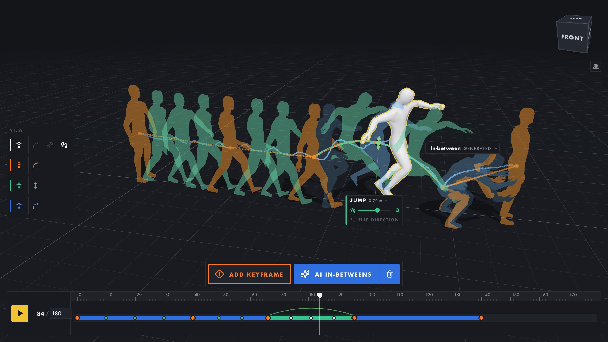
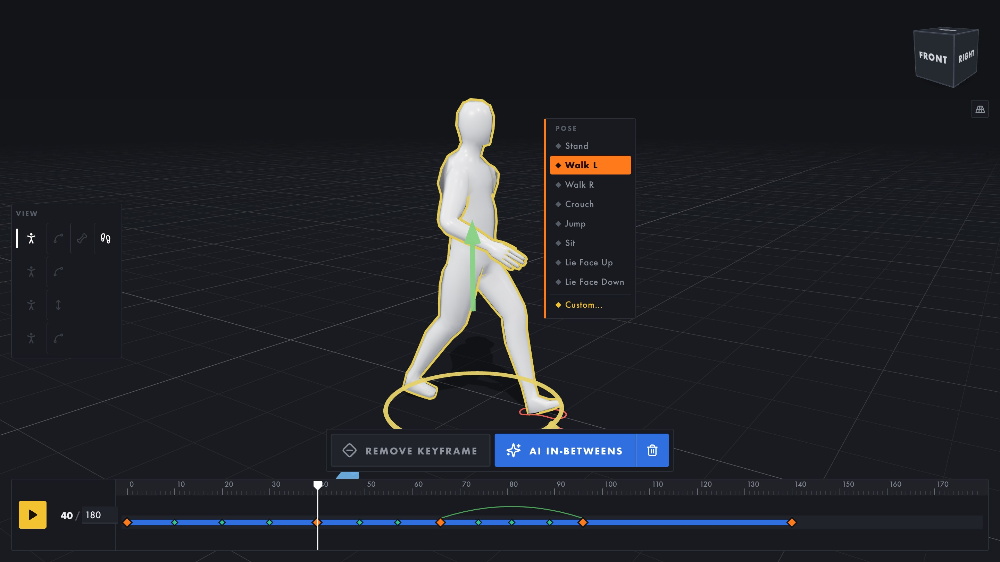
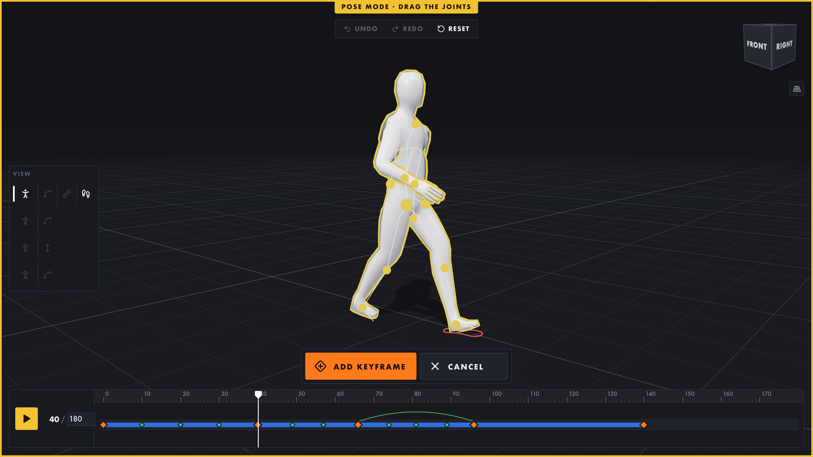
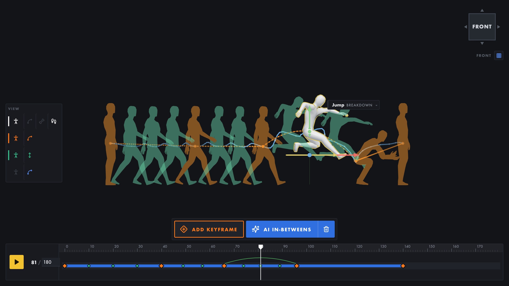
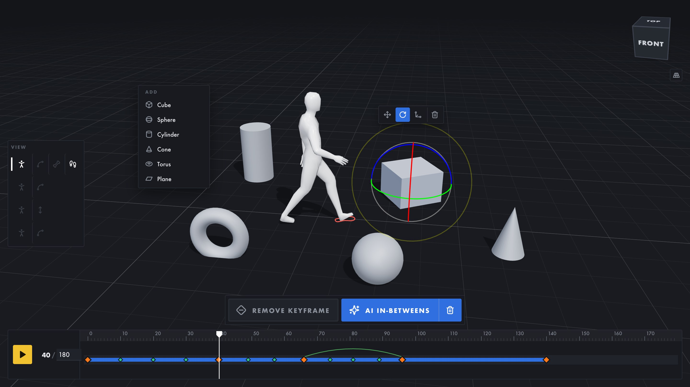

# MotionBricks Studio

A local keyframe editor for [NVlabs/motionbricks](https://github.com/NVlabs/motionbricks).
Put a few poses on a timeline, press **AI In-betweens**, and MotionBricks fills in the motion between them.



```bash
./setup.sh   # once: clones motionbricks next to this folder, fetches its LFS assets, makes .venv, runs npm install
./run.sh     # then open http://127.0.0.1:8765
```

`setup.sh` uses `uv` for Python and `npm` for the front end (three.js and Lucide icons).

## How it works

- **No NVIDIA GPU needed.** The official runtime needs TensorRT and an NVIDIA GPU.
  `server/engine.py` ports the SOMA engine's encode, decode and endpoint-correction kernels
  (`motionbricks/model/soma/kernels.py`) to numpy and runs the bundled ONNX model on ONNX Runtime CPU.
  Apple Silicon works too: one generation takes about 20 ms on an M5 Pro.
- **Pose library** (`server/library.py`). Every pose is a frame from the sample BVH clips, grounded on the floor:
  Stand, Walk L, Walk R (the walk's two stride extremes), Crouch, Jump, Sit (from the chair-sitting clip, so it sits on
  an invisible chair), and Lie Face Up / Lie Face Down (the standing pose laid flat).
  Moving poses pass four target frames to the model, so it carries their momentum. Still poses pass one, so it stops there.
- **What's saved.** Your keyframes and shapes are saved in the browser (localStorage); generated motion is not.
  Each segment between two keyframes is generated on demand. It's cached by a signature of every keyframe up to
  the segment's end, since each segment starts from where the previous one ends. Change a keyframe and the
  segments after it show **Out of sync**. Add keyframes past the end and they show **New keyframes**. Generating
  again reruns from the first segment that's out of date.
- **Timing.** The model picks 17–57 frames per segment. The server limits it to token counts near your keyframe
  spacing, then retimes the result to fit exactly. If the gap is too long, it holds the final pose.
- **Spans and breakdowns.** The stretch between two keyframes is a span, and each span is a **Walk** or a **Jump**.
  A jump arcs over the span. Its green handle sets how high the feet clear the floor.
  A span's breakdown slider adds up to 12 extra poses along the path:
  - walk spans get alternating Walk L / Walk R steps,
  - jump spans get jump poses on the arc.
  **Flip direction** turns a span's breakdowns to face back along the path. Breakdowns are computed, not saved,
  and the AI runs through them, so the motion follows the path and the arc.
- **Mannequin.** `web/models/Xbot.glb` is the Mixamo X Bot as shipped in the three.js examples
  (`examples/models/gltf/Xbot.glb`). `web/js/mannequin.js` retargets SOMA poses onto it:
  - It pairs SOMA's *stand* pose with the X Bot's *idle* clip to get one fixed offset per bone.
  - Every frame it matches arm and leg directions exactly. The feet just follow their calibrated rotation, so soles stay flat.
  - A ground clamp lifts the body whenever a heel, toe or knee would go below the floor.

  Mixamo characters can be used in your own projects but not redistributed as standalone assets, so swap in
  your own model before sharing this outside your team.

## Using it

| Pick a pose | Pose by hand |
|---|---|
|  |  |

### Keyframes and poses

| | |
|---|---|
| Pick a time | Click or drag the ruler at the top of the timeline (← / → step, Shift for 10, Home goes to 0) |
| Pick a pose | Click the pose name beside the mannequin, scroll over it, or press ↑ / ↓ |
| Place | Drag the mannequin, or use its gizmo: red/blue arrows move it, the green arrow lifts it, the ring turns it (Shift snaps 15°) |
| Keyframe | **Add Keyframe** (K / Enter). On a keyframe the button removes it (also Del) |
| Edit a saved pose | Click its orange ghost to make it active, then move it where it stands |
| Pose by hand | Pose list → **Custom…** opens pose mode. Drag the yellow joints or click one for its gizmo. Add Keyframe keeps the pose, Esc cancels. Ctrl/Cmd+Z undo, Shift+Ctrl/Cmd+Z redo |
| Keep an in-between | On a generated frame, Add Keyframe saves that in-between pose as a keyframe |
| Generate | **AI In-betweens** (G). The trash button beside it clears the generated motion |
| Play | Space |

### Timeline

| | |
|---|---|
| Select keyframes | Click a diamond (Shift toggles), or drag on empty track to box-select |
| Retime | Drag selected diamonds |
| Copy / cut / paste / delete | ⌘C / ⌘X / ⌘V (pastes at the playhead) / Del, or right-click the track |
| Span settings | Click a gap between two keyframes, or the path between them in the viewport |

### Viewport

| Side view, orthographic | Shapes |
|---|---|
|  |  |

| | |
|---|---|
| Orbit / pan / zoom | Left drag / right drag / middle drag or scroll |
| View cube (top right) | Click a face, edge or corner to snap there in orthographic. Arrows step to the next face. Drag it to orbit. The button under it switches perspective / orthographic |
| Add a shape | Right-click (without dragging): Cube, Sphere, Cylinder, Cone, Torus, Plane |
| Edit a shape | Click it, then use its toolbar or W / E / R (move / rotate / scale). Del removes it, Esc deselects |
| Collisions | A mannequin you drag stops at shapes (its box against theirs) and slides along their sides |

### View menu (left)

Each row is a layer and the parts that go with it. The number key toggles it.

| Row | Toggles |
|---|---|
| Mannequin | Mannequin 3 · joint paths 7 · bones 6 · foot contacts 9 (red outlines on the floor where a foot is down) |
| Saved poses | Orange ghosts 1 · their path 4 |
| Breakdowns | Green ghosts 8 · jump height handles 0 |
| In-betweens | Blue onion skins 2 · generated hip path 5 |

## Files

| | |
|---|---|
| `server/server.py` | HTTP server: the web app, `GET /api/library`, `POST /api/segment` |
| `server/engine.py` | numpy + ONNX Runtime port of the SOMA engine |
| `server/library.py` | Pose library and key-pose windows for the model |
| `server/bvh.py`, `server/quat.py` | BVH loading, forward kinematics, quaternion maths |
| `web/js/app.js` | The editor: scene, keyframes, spans, generation, gizmos, shapes |
| `web/js/mannequin.js` | X Bot retargeting, ground clamp, picking |
| `web/js/timeline.js` | Canvas timeline |
| `web/js/viewcube.js` | View cube |
| `web/js/icons.js` | Inlined Lucide icons (ISC licence) |
